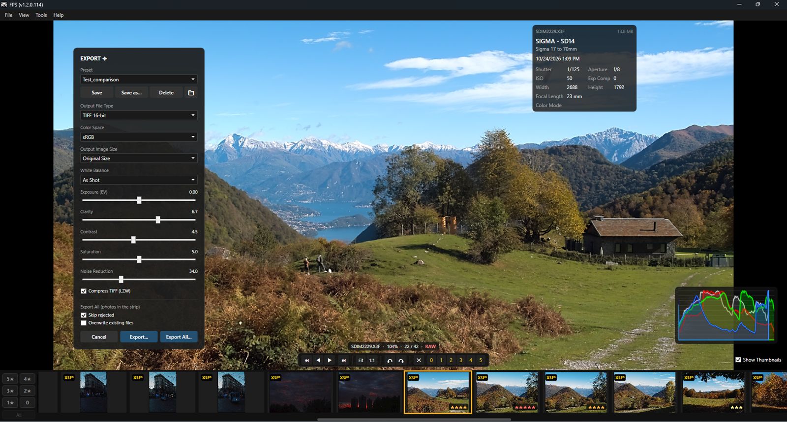

# 📸 FPS—Feedback & Issue Tracker

Welcome to the feedback repository for **FPS**, a high-performance Windows desktop application for culling and inspecting RAW images (including Foveon X3F files).

This repository is dedicated to tracking **bug reports**, **feature requests**, and **performance feedback**.

---

## About FPS

FPS is a fast Windows desktop app for culling and reviewing photos,
built for Sigma Foveon shooters who find Sigma Photo Pro too slow.

- Native X3F decoding (SD9/SD10 through Merrill and Quattro)
- DNG, CR2, ARW, JPEG and TIFF support
- Instant preview, smooth zoom & pan, 100% inspection
- 0–5 star ratings, reject flag, rating filters
- EXIF panel and live histogram
- 16-bit TIFF export with exposure, contrast, clarity and noise reduction

**Requirements:** Windows 10/11 (64-bit)

## 📢 Current Release v1.3.0

### New
- **GPU acceleration (OpenCL)** for noise reduction, sharpening and sd/dp Quattro RAW development.
  Enable or disable it with *Preferences → Use GPU*; the detected graphics card and its status are shown there.
  If the GPU is not available or fails, FPS falls back to the CPU automatically.
- **Highlight clipping warning (zebra)**: press **J** (or tick *Zebra (J)*) to show diagonal stripes over blown highlights.
  For X3F files it is computed from the RAW sensor data, so it shows real sensor saturation;
  for JPEG, TIFF, DNG and other RAW formats it is based on the displayed image.

### Improved
- **Blown highlights** on DP Merrill, sd/dp Quattro and early DP1/DP2 files now render as clean, neutral white
  instead of pink, magenta or grey casts.
- **Faster shadow noise reduction.**
- The photo on screen is always processed first: background preloading no longer delays it.
- Smoother response of the sliders while adjusting the export preview.

### Notes
- The zebra is shown on the main view only (not yet on the B side of Compare).
- Keyboard shortcuts (H) and the welcome screen now include the J key.

## Release v1.2.0  

Improved

More reliable license and update checks on unstable connections.
Added Compare images to context menu.

## Release v1.2.1

New

Saturation slider in the Export panel. Range 0–10, default 5 (unchanged). Lowering it brings oversaturated and clipped colors back into range before they are cut off, which recovers texture in strong reds, flowers and lights. At 0 the image becomes monochrome at the same brightness.
Export presets now store Saturation. Presets saved with earlier versions load with the default value (5).

Improved

SD14 / SD15: cleaner TIFF exports. The small dark speckles in shadows and mid-tones are gone, and noise reduction now works as expected across the whole slider range.
Merrill (DP1M / DP2M / DP3M, SD1 Merrill): finer detail. Sharpening and micro-contrast are now much closer to Sigma Photo Pro, without halos on edges.
sd Quattro H: more accurate colors and tones. Reds are rendered more faithfully, and shadows and overall brightness are better aligned with Sigma Photo Pro (checked on a ColorChecker).

---

## 🚀 How to Submit Feedback

To keep issues organized and easy to track, please use the **[Issues](../../issues)** tab.

### 🐛 Reporting a Bug
If you encounter a crash, rendering issue, or unexpected behavior:

1. Check the **[Issues](../../issues)** list to make sure the problem hasn't already been reported.
2. Click **New Issue** (select *Bug Report*) and provide:
   - **FPS Version:** (e.g., `v0.4.1`)
   - **Environment:** Windows version (e.g., Windows 11 23H2) and display resolution/scaling.
   - **Camera / File Format:** (e.g., Sigma SDQH, Quattro DP0, `.X3F`, `.DNG`, `.JPG`).
   - **Steps to Reproduce:** Clear, step-by-step instructions.
   - **Expected vs. Actual Behavior:** What you expected to happen vs. what actually occurred.
   - *(Optional)* Screenshots, screen recordings, or log files.

> ⚠️ **Note on X3F / RAW Files:** If an issue only occurs with a specific file or camera model, mentioning the camera model and shooting settings helps immensely when isolating decoding bugs.

---

### 💡 Requesting a Feature
Have an idea to speed up culling or improve the UI?

1. Open a new **Issue** (select *Feature Request*).
2. Describe:
   - The bottleneck or problem in your workflow it helps solve.
   - How you envision the feature working (e.g., keyboard shortcuts, UI controls, rating/tagging workflow).

---

## 💬 Discussions & General Feedback

For informal feedback, performance impressions, or general ideas, feel free to use the **[Discussions](../../discussions)** tab.

---

## 🛠 Project Status

FPS is under active development. Community and beta tester feedback directly shapes the roadmap—focusing on raw decoding speed, smooth zoom/pan interaction, keyboard workflows, and culling performance.

*Thank you for helping make FPS faster and more reliable!*
